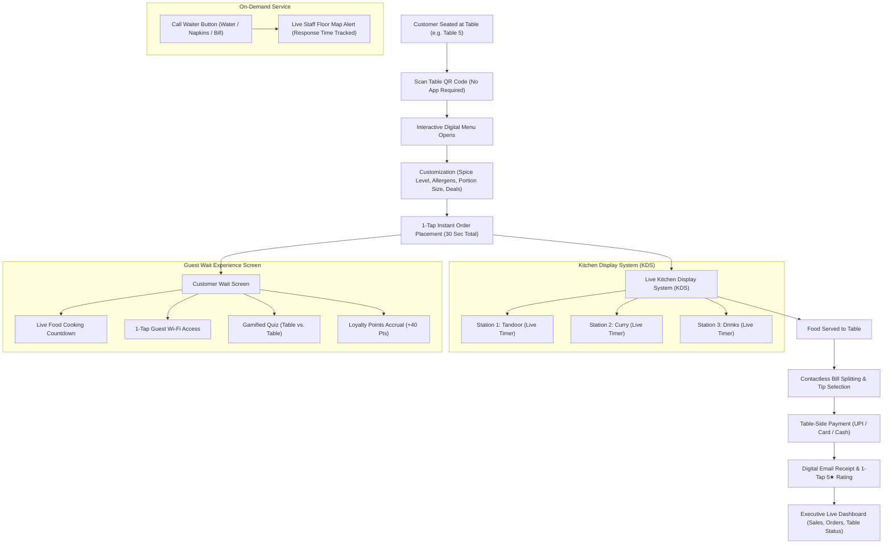

# 🍽️ Smart Restaurant Digital Ecosystem: System Analysis & Architecture Specification
> **Based on Video Analysis of the Next-Generation Restaurant Ordering & Management System ("Zero-Waiter Model")**

---

## 📌 Executive Summary

The analyzed video demonstrates an end-to-end, contactless, automated restaurant operating ecosystem designed to eliminate operational friction, reduce waiter dependency to zero for routine tasks, and accelerate the ordering-to-kitchen pipeline from traditional 5–15 minutes down to **30 seconds**.

### Core Value Proposition:
- **Zero Waiter Dependency for Routine Tasks:** Customers handle browsing, customization, ordering, service requests, bill splitting, and payments directly from their smartphones without installing any mobile app.
- **Station-Specific Kitchen Display System (KDS):** Automated routing of ordered items directly to individual kitchen prep stations (Tandoor, Curry, Drinks) with real-time countdown timers.
- **Interactive Waiting Experience:** Keeps guests engaged during food preparation through live cooking countdowns, 1-tap guest Wi-Fi access, gamified trivia quizzes (Table vs. Table), and instant loyalty rewards.
- **Single-Screen Executive Operations Dashboard:** Complete real-time visibility into table occupancy, revenue metrics, order velocity, floor service alerts, and customer satisfaction ratings.

---

## 🔄 End-to-End Customer & Operations Workflow



---

## 📱 Detailed Module & Feature Breakdown

### 1. Zero-Friction QR Onboarding (Scan Phase)
- **Mechanism:** Dynamic QR code mounted on physical dining tables (e.g., Table 5).
- **Execution:** Scanned using any standard smartphone camera.
- **Zero-Friction Access:** Launches directly into the web browser without app downloads, registration walls, or account creation.
- **Context Injection:** Automatically detects and locks the active Table Number (`Table 5`), session token, and Dine-In context.

---

### 2. Smart Dynamic Menu & Item Customization
- **Category Navigation:** Tabbed navigation across `Starters`, `Mains`, `Breads`, `Drinks`, and `Desserts` with instant keyword search.
- **Item Deep-Dive Modal:**
  - **Visuals & Pricing:** High-definition dish imagery, clear pricing (e.g., *Paneer Makhani ₹320*), and ingredients description.
  - **Spice Level Selector:** Interactive 3-tier selector (`Mild`, `Medium`, `Spicy`).
  - **Allergen Transparency:** Prominent badges indicating dietary allergens (`Dairy`, `Nuts`, `Gluten`).
  - **Portion Sizing:** Toggle between `Half` and `Full` with dynamic price calculation.
  - **Contextual Cross-Selling / Deals:** One-click add-on promos (e.g., *Deal: + Mango Lassi ₹99*).
  - **Action Button:** Sticky, high-contrast "Add to order • ₹XXX" button.

---

### 3. 1-Tap Instant Order Dispatch
- **Friction Comparison:**
  - *Traditional ("Pehle"):* Calling waiter (`"Bhaiya, order!"`), waiting for order notepad transcription (avg. 4–5 minutes delay).
  - *Smart System ("Ab"):* 1-Tap instant checkout directly from the digital cart.
- **Real-Time Notification:** Instant visual confirmation with animated progress ring: *"Order Placed • Table 5 • 5 Items • ₹1,200"*.
- **Transit Time:** Order reaches kitchen prep stations within **30 seconds** of sitting down.

---

### 4. Live Multi-Station Kitchen Display System (KDS)
- **Automatic Routing by Food Category/Station:**
  - **Tandoor Station:** Breads, Tikkas, Kebabs (e.g., *Garlic Naan x4*, *Paneer Tikka*).
  - **Curry Station:** Gravies, Biryanis, Dal (e.g., *Paneer Makhani*, *Dal Makhani*, *Veg Biryani*).
  - **Beverage / Bar Station:** Cold/Hot drinks (e.g., *Mango Lassi x2*, *Masala Chai*).
- **Live Prep Timers:** Each item/ticket tracks active cooking duration countdowns (e.g., `00:14`, `00:22`, `00:28`).
- **Ticket Header:** Clear table identification, order sequence number (`T5 - #214`), and real-time live clock sync (`LIVE 20:41`).

---

### 5. Smart Guest Wait Experience & Gamification
Transforms perceived wait time from frustrating delay into an engaging experience:
1. **Live Countdown Progress Ring:** Circular timer showing remaining cooking time (e.g., `11:48 min left`) with status markers: `Ordered` ➔ `Cooking` ➔ `Ready`.
2. **1-Tap Guest Wi-Fi Connect:** Shows network name (`Tadka_Guest`) and password (`tadka2026`) with a single-click copy button.
3. **Gamified Table-vs-Table Trivia (Spice Quiz):**
   - Multiplayer live trivia engaging adjacent tables (e.g., *Table 5 vs Table 2*).
   - Real-time scoring and fun culinary questions (e.g., *"Sabse teekhi mirch kaunsi hai?"*).
4. **Instant Loyalty Accrual:**
   - Visual points counter (e.g., `+40 Points • 139 / 200 Points`).
   - Progress meter toward rewards (e.g., *"Unlock Free Mango Lassi at 200 points"*).

---

### 6. Digital Service Call ("Call Waiter") & Live Floor Map
- **Customer Service Bell ("DING!"):**
  - Prominent digital assistance button on the customer device.
  - Granular quick-select needs:
    - 💧 `Water`
    - 🧻 `Napkins`
    - 🧾 `Bill`
  - Instant acknowledgement: *"Waiter is coming..."*.
- **Staff Live Floor Map (Tablet / POS):**
  - Grid visualization of all restaurant tables (`T1` through `T6`).
  - Real-time table states: `Eating`, `Ordering`, `Bill`, `Help`.
  - Pulsing orange/red highlight on alert table: *"T5 Needs help • CALLED 8 SEC AGO"*.
  - Live SLA tracking: Shows staff exact response time (e.g., *"8 SEC"*).

---

### 7. Table-Side Bill Splitting & Multi-Channel Payment
- **Friction Comparison:**
  - *Traditional ("Pehle"):* Calling for bill, waiting for printed invoice, handing card/cash, waiting for change/charge slip (avg. 10–15 minutes).
  - *Smart System ("Ab"):* Instant digital checkout directly from the seat.
- **Smart Bill Splitting:**
  - Flexible split options: `1 way`, `2 ways`, `3 ways`, or custom itemized division.
  - Visual participant avatar breakdown (e.g., Person A pays ₹660, Person B pays ₹660).
- **Interactive Gratuity / Tip Selector:** Quick-select tip percentage buttons (`5%`, `10%`, `15%`).
- **Payment Gateway Integrations:**
  - ⚡ **UPI** (Google Pay, PhonePe, Paytm, BHIM) via deep-link or dynamic QR.
  - 💳 **Credit / Debit Cards**.
  - 💵 **Cash** (notifies staff to collect cash at table).
  - 🏦 **Net Banking / Bank Transfer**.
- **Instant Payment Confirmation:** High-visibility green checkmark receipt screen: *"Paid ₹660 • Table 5"*.

---

### 8. Digital Eco-Receipts & 1-Tap Customer Reviews
- **Contactless Eco-Receipt:** Itemized bill generated and sent automatically via Email or SMS.
- **1-Tap Feedback Collection:**
  - Post-payment screen displays *"How was your meal?"*.
  - Interactive 5-star rating interface.
  - Single tap submits review (`5.0 ★ Review posted`), capturing high-value customer feedback instantly.

---

### 9. Executive Live Operations & Business Analytics Dashboard ("Ek Screen Par")
Consolidates the entire restaurant's operational pulse into one unified manager screen:
- **Real-Time KPIs:**
  - **Live Table Occupancy:** `6/6 Tables Occupied` (100% capacity).
  - **Order Velocity:** Live order counter (e.g., `46 orders` tonight).
  - **Gross Revenue:** Real-time revenue counter (e.g., `₹48.4K`).
  - **Customer Rating Aggregate:** Live feedback score (e.g., `4.9 ★`).
- **Interactive Floor Status Diagram:** Centralized Kitchen hub connected via dynamic data lines to all active tables with color-coded status badges.

---

## 📊 Traditional Restaurant vs. Smart E-Menu Comparison

| Dimension | Traditional Restaurant Flow ("Pehle") | Smart Restaurant Flow ("Ab") | Efficiency Gain |
| :--- | :--- | :--- | :--- |
| **Order Placement Time** | 4 – 10 minutes (waiting for waiter) | **30 seconds** (1-tap from smartphone) | **85% – 90% Faster** |
| **Kitchen Transit Time** | 3 – 5 minutes (handwriting & walking) | **Instant (< 1 sec)** via WebSockets | **100% Real-time** |
| **Kitchen Station Routing** | Manual sorting of paper tickets | **Automated** by station (Tandoor, Curry, Bar) | **Zero routing errors** |
| **Wait Time Experience** | Idle, impatient waiting | **Interactive:** countdown, Wi-Fi, games, points | **Higher customer retention** |
| **Calling for Service** | Waving hands, seeking eye contact | **Digital bell** with specific requests (Water/Napkins) | **Average 8 sec response** |
| **Bill Settlement** | 10 – 15 minutes (split math, cash/card terminal) | **Instant table-side split** + UPI/Card payment | **90% Faster turnover** |
| **Table Turnover Rate** | 60 – 75 minutes per seating | **35 – 45 minutes** per seating | **~35% Increase in daily covers** |

---

## 🗄️ Architectural Data Model (Database Schema Reference)

```sql
-- 1. Tables & Floor Plan
CREATE TABLE restaurant_tables (
    id UUID PRIMARY KEY DEFAULT gen_random_uuid(),
    table_number VARCHAR(10) UNIQUE NOT NULL,
    capacity INT DEFAULT 4,
    status VARCHAR(20) DEFAULT 'available', -- 'available', 'occupied', 'ordering', 'eating', 'bill_requested'
    qr_code_url TEXT NOT NULL,
    current_session_id UUID
);

-- 2. Menu Items & Station Mapping
CREATE TABLE menu_items (
    id UUID PRIMARY KEY DEFAULT gen_random_uuid(),
    name VARCHAR(100) NOT NULL,
    category VARCHAR(50) NOT NULL, -- 'starters', 'mains', 'breads', 'drinks', 'desserts'
    station VARCHAR(50) NOT NULL,  -- 'tandoor', 'curry', 'drinks', 'desserts'
    price DECIMAL(10,2) NOT NULL,
    spice_levels TEXT[] DEFAULT ARRAY['mild', 'medium', 'spicy'],
    allergens TEXT[] DEFAULT ARRAY[]::TEXT[],
    portion_sizes JSONB DEFAULT '{"half": 0.6, "full": 1.0}'::JSONB,
    image_url TEXT,
    is_available BOOLEAN DEFAULT true
);

-- 3. Live Orders & Station Tickets
CREATE TABLE orders (
    id UUID PRIMARY KEY DEFAULT gen_random_uuid(),
    table_number VARCHAR(10) NOT NULL,
    order_number VARCHAR(20) NOT NULL,
    status VARCHAR(30) DEFAULT 'placed', -- 'placed', 'cooking', 'ready', 'served', 'completed'
    total_amount DECIMAL(10,2) NOT NULL,
    created_at TIMESTAMP WITH TIME ZONE DEFAULT NOW(),
    estimated_prep_minutes INT DEFAULT 15
);

CREATE TABLE order_items (
    id UUID PRIMARY KEY DEFAULT gen_random_uuid(),
    order_id UUID REFERENCES orders(id) ON DELETE CASCADE,
    menu_item_id UUID REFERENCES menu_items(id),
    station VARCHAR(50) NOT NULL,
    quantity INT DEFAULT 1,
    spice_level VARCHAR(20),
    portion_size VARCHAR(20),
    selected_deal TEXT,
    station_status VARCHAR(30) DEFAULT 'pending', -- 'pending', 'cooking', 'done'
    timer_started_at TIMESTAMP WITH TIME ZONE
);

-- 4. Service Calls (Call Waiter)
CREATE TABLE service_requests (
    id UUID PRIMARY KEY DEFAULT gen_random_uuid(),
    table_number VARCHAR(10) NOT NULL,
    request_type VARCHAR(50) NOT NULL, -- 'water', 'napkins', 'bill', 'general'
    status VARCHAR(20) DEFAULT 'pending', -- 'pending', 'acknowledged', 'resolved'
    created_at TIMESTAMP WITH TIME ZONE DEFAULT NOW(),
    resolved_at TIMESTAMP WITH TIME ZONE
);

-- 5. Bill Splitting & Payments
CREATE TABLE payments (
    id UUID PRIMARY KEY DEFAULT gen_random_uuid(),
    order_id UUID REFERENCES orders(id),
    table_number VARCHAR(10) NOT NULL,
    split_type VARCHAR(20) DEFAULT 'single', -- 'single', 'equal_split', 'by_item'
    split_count INT DEFAULT 1,
    amount_paid DECIMAL(10,2) NOT NULL,
    tip_amount DECIMAL(10,2) DEFAULT 0.00,
    payment_method VARCHAR(30) NOT NULL, -- 'upi', 'card', 'cash', 'netbanking'
    payment_status VARCHAR(20) DEFAULT 'successful',
    created_at TIMESTAMP WITH TIME ZONE DEFAULT NOW()
);

-- 6. Feedback & Loyalty
CREATE TABLE customer_reviews (
    id UUID PRIMARY KEY DEFAULT gen_random_uuid(),
    table_number VARCHAR(10) NOT NULL,
    order_id UUID REFERENCES orders(id),
    rating DECIMAL(2,1) CHECK (rating >= 1.0 AND rating <= 5.0),
    feedback_text TEXT,
    created_at TIMESTAMP WITH TIME ZONE DEFAULT NOW()
);
```

---

## 🎯 Implementation Roadmap for FinallWAve

To transform the current `FinallWAve` project into this exact complete ecosystem:

| Phase | Feature Module | Target Implementation |
| :--- | :--- | :--- |
| **Phase 1** | **Item Customization Modal** | Add spice level radio pills (`Mild`, `Med`, `Hot`), portion size toggle (`Half`/`Full`), and allergen tags to `CustomerMenu.tsx`. |
| **Phase 2** | **Multi-Station Kitchen KDS** | Expand Admin view into station tabs (`Tandoor`, `Curry`, `Beverages`) with live cooking countdown timers per order ticket. |
| **Phase 3** | **Interactive Wait Screen** | Build the post-order tracking screen featuring dynamic countdown ring, 1-tap WiFi credential card, and mini-trivia quiz. |
| **Phase 4** | **Digital Service Bell & Floor Map** | Implement the floating `"Call Waiter"` button on customer devices and the real-time floor map on staff devices with audio chime and SLA counter. |
| **Phase 5** | **Split Bill & Table Payment** | Add the 1-2-3 split payment calculator, tip selector, and table-side UPI QR payment modal. |
| **Phase 6** | **Real-Time Executive Dashboard** | Live ticker bar on Manager dashboard showing active tables (`X/Total`), order velocity, live sales counter, and average rating. |
